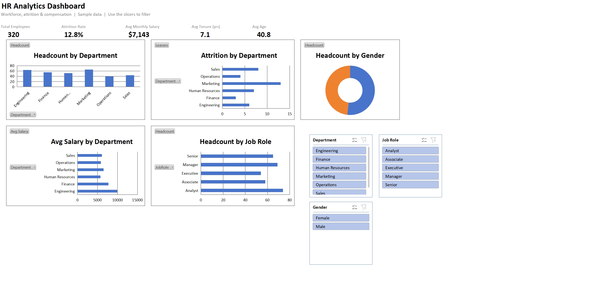

# 👥 HR Analytics Dashboard (Interactive Excel)

A fully **interactive HR analytics dashboard** built in Excel with **PivotTables, PivotCharts, and slicers** — analyze workforce headcount, attrition, and compensation, and filter the whole view by Department, Gender, or Job Role.

> **Author:** Hassan Khan · BI / People Analytics
> **Tools:** Microsoft Excel · PivotTables · PivotCharts · Slicers · GETPIVOTDATA

---

## 🖼️ Dashboard Preview

*Download **[`HR-Analytics-Dashboard.xlsx`](HR-Analytics-Dashboard.xlsx)** and click the slicers — every KPI and chart updates live.*

---

## 🎯 Business Questions Answered
- What is our **total headcount, attrition rate, average salary, tenure, and age**?
- Which **departments** have the highest **attrition**?
- How is **headcount distributed** by department, gender, and job role?
- How does **average salary** vary by department?

## 📌 Key Insights (sample data)

| Metric | Value |
|--------|-------|
| Total Employees | **320** |
| Attrition Rate | **12.8%** |
| Avg Monthly Salary | **$7,143** |
| Avg Tenure | **7.1 yrs** |
| Avg Age | **40.8** |

- ⚠️ **Marketing (20%)** and **Sales (18.2%)** have the highest attrition — priority areas for retention.
- 💰 **Engineering** has the highest average salary (~$9,959), reflecting specialized roles.
- 🧑‍🤝‍🧑 Workforce is **gender-balanced** (166 female / 154 male).
- 🏢 **Marketing** and **Engineering** are the largest departments by headcount.

---

## ⚙️ What This Demonstrates

| Component | Technique |
|-----------|-----------|
| KPI cards | `GETPIVOTDATA` (count, average, ratio) that recalc on filter |
| Headcount by Dept / Role | PivotCharts (column & bar) |
| Attrition by Department | PivotChart on an attrition flag (Sum) |
| Gender split | Doughnut PivotChart |
| Avg salary by Dept | Average aggregation PivotChart |
| Slicers | Department, Gender, Job Role — connected to all pivots |

## 🚀 How to Use
1. Download **[`HR-Analytics-Dashboard.xlsx`](HR-Analytics-Dashboard.xlsx)** and open in Excel (2016+/365).
2. On the **Dashboard** sheet, click any slicer value to filter every chart and KPI.
3. Data lives on the **Data** sheet; pivots on a hidden **Calc** sheet.

## 📁 Dataset
[`data/hr_employee_data.csv`](data/hr_employee_data.csv) — **320 employees** with department, job role, gender, age, tenure, monthly salary, performance rating, and attrition flag.

---

## 🛠️ Skills Demonstrated
`Excel` · `PivotTables` · `PivotCharts` · `Slicers` · `People Analytics` · `Attrition Analysis` · `Dashboard Design`

---

⭐ Part of my data analytics portfolio. Uses generated sample data. Contact: khanhassan718@yahoo.com
